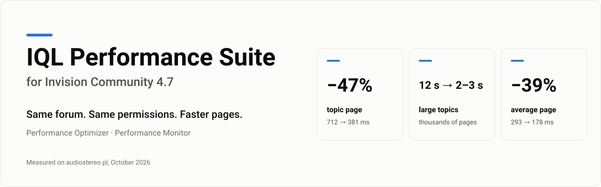
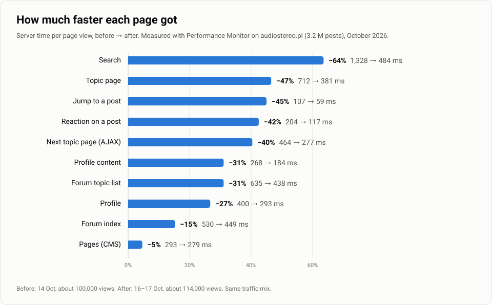

**IQL Performance Suite** makes Invision Community 4.7 forums faster without changing what they show. It is two plugins: **Performance Optimizer** removes work IPS does for nothing, and **Performance Monitor** measures every page, so you see the gain on your own forum.

[Po polsku](README.pl.md) · [Changelog](CHANGELOG.md) · [iql.pl](https://iql.pl)

This repository is the public release channel: current versions, changelog and results. The code and the plugin files are not here.

## Current versions

| Plugin | Version | Released | For |
| --- | --- | --- | --- |
| Performance Optimizer | 1.24.1 | 2026-10-27 | Invision Community 4.7 |
| Performance Monitor | 1.8.0 | 2026-10-22 | Invision Community 4.7 |

IPS checks for new versions on its own (every copy has a lifetime licence for now, no key needed): each plugin reads its file in this repository ([`optimizer/latest.json`](optimizer/latest.json), [`monitor/latest.json`](monitor/latest.json)) and the ACP shows a "new version" badge next to the plugin.

## Results

**Large topics** with thousands of pages took about 12 s to open, and now take 2–3 s at most. The main cause was one IPS query for a topic's first and last post, which walked the date index of the whole forum: 4.018 s → 0.001 s on a forum with 3.2 million posts.

Results depend on the forum: its size, theme, add-ons, hosting and the distance to the database. The largest gains come on big forums with the database on a separate server, long topics, many language strings, Pages blocks and clubs. Performance Monitor shows before and after on yours.

## What we guarantee

| Guarantee | How it is checked |
| --- | --- |
| Same output as plain IPS: the same pages, posts, lists and API responses | Every test case runs twice, plain IPS and with the fix, and the results must match, also on a real MariaDB 10.4 with random data. |
| Permissions unchanged: no leaked forums or hidden content | Permissions are still checked by IPS's own code. Tests run for 5–6 viewers (guest, member, secondary groups, admin, club member), and deliberately broken variants, such as a missing permission condition, must fail them. |
| Every fix can be switched off on its own | A switch in the ACP. A test checks that the plugin's code does not run when it is off. |
| Redis going down does not break the forum | On a Redis error the fix hands over to IPS. Every Redis-based fix is tested with Redis gone. |
| Changes made in IPS show at once | Data kept longer than one request (language strings, club lists) moves to a new version on every write made by IPS. Tested for edits, additions and deletions. |
| No changes to the database structure or to IPS files | No tables, columns or indexes are added. Uninstalling leaves plain IPS. |
| Works with your other add-ons | A test loads every class hooked by the installed applications. A conflict that would take a forum down is caught before release. |

The one intended difference from IPS: notification emails go out right after the page is sent, instead of before it. They are the same emails, in the same order. The Elasticsearch fix (1.12.0) corrects an IPS bug: with "Maximum Results" below 1000 the index gets what IPS sends with 1000 or more. Since 1.19.0 the search index (Elasticsearch) is also changed right after the page is sent, by IPS's own code; when one request changes the same topic several times, the index ends up as IPS leaves it when those changes come one by one.

## What Performance Optimizer fixes

| Fix | What IPS did | Measured |
| --- | --- | --- |
| Language strings | Scanned the whole page once per phrase, four times over (about 11,000 scans on a topic page) | Topic page: 403 → 32 ms; a 1.2 MB page: 2.3 → 0.04 s |
| Language strings in the REST API | Re-encoded every phrase for every text in the response | Large response: 2.4–2.8 → 0.04–0.05 s; no more app timeouts |
| A topic's first and last post | Walked the date index of the whole forum | 4.018 → 0.001 s per query; since 1.17.0 the same post as IPS also when two posts share a second |
| Pages of large topics (1.13.0) | For the first and the last pages, walked the date index of the whole forum | Page 1 of topics with 12,000–110,000 posts: 0.6–3.6 s → 0.5–0.7 ms (test database, 3.1 million posts) |
| Topic pages in the REST API for moderators (1.16.0) | With hidden=1, for the first and the last pages of large topics, walked the date index of the whole forum | 0.1–1.9 s → 0.3–1.4 ms (test database, 0.5 million posts); 2–14 s → 0.5 ms (3.2 million posts) |
| Profile fields next to posts (1.14.0) | Selected the list of profile fields once per author on the page and, in archived topics, each author's values one by one | About 9 ms per topic page; archived topic with 16 authors: 50 → 20 queries |
| Profile fields in the REST API (1.15.0) | Selected the author's profile field values once for every post, topic and record in a response, the same member again and again | List of 35 records by 6 authors: 27–28 → 6 queries (before: 17.5 per page of a topic's posts, 35 per list of records) |
| Reactions, tags and ratings in REST API lists (1.21.0) | Asked about the reactions, tags and rating of every post, topic and Pages record of a page on its own | List of 35 Pages records: 73 → 2 such queries (about 70 ms on the forum); page of 25 posts: 27 → 3 queries |
| Front page for logged-in members (1.22.0) | Read every topic of the forum into a temporary table and sorted it, because of the condition for the member's own unapproved topics | 7.9 s → 4.2 ms for a member on the forum, the same topics (needs one index) |
| Leaderboard (1.22.0) | Ran its slowest queries on every view | 6.4 s + 2.6 s → kept for 5–60 minutes |
| Opening notifications (1.22.0) | Stamped every notification of the member as read again | Only the unread ones: 41–90 → 6–12 ms for members with 4000–6600 notifications (test database) |
| Clubs under post authors (1.23.0) | Threw away every cached club list on each run of the club rebuild task, even when nothing changed | Lists kept for 6 hours and renewed only on a real change |
| Notifications (1.23.0) | Read every notification's post, topic and author one by one | One query per page of notifications, in the dropdown and in the REST API |
| Badges of post authors (1.24.0) | Asked for the badges of each post's author on its own | One query per topic page (25 posts: 25 → 1) |
| "Who's viewing" (1.24.0) | Decoded every online session for a box that lists only members | 1000 sessions: 8.6 → 0.6 ms |
| PHP 8.1 deprecations (1.24.0) | Built an exception with a full backtrace for every deprecation notice and threw it away | About 940 notices per topic page dropped at once |
| File URLs in posts | Replaced the storage tag once per image | 160 posts: 198 → 4 ms |
| Recognize | Queried the database before checking the permission | About 50 fewer queries per topic page |
| Datastore from Redis | Read every key on its own | About 130 fewer Redis commands per request |
| Clubs of forums | One query per club forum | Search form: about 270 queries → 3–4 |
| Forum tree | One query per forum for its children | Search form: about 490 queries and 410 ms → a few queries |
| Theme tree | One query per theme for its children, on every page | About 8 queries → 1–2 on every page |
| Pages database pages | One query per database page | About 14 queries → 2 per topic and reaction |
| Language strings from Redis | One query with about 2,800 phrases on every page | About 26 ms → no query |
| A post author's clubs | Two queries per post | About 44 queries and 53 ms per topic → almost none |
| Topic without the whole forum tree | Loaded about 500 forums before every topic | About 40 ms per topic view |
| Post notes (postnotes add-on) | Two queries per post | 23 queries and 21 ms → 1 query |
| Application extensions | Read and decoded a file on every call | About 52 ms per topic page |
| Notification emails | Sent them over SMTP before the page went back to the user | Reacting no longer waits about 240 ms for the mail server |
| Template copies on disk | After a cache clear it could rewrite a stale copy on every request | 50–70 ms per topic page and no more "Class … not found" errors |
| Pages blocks | One query per block and per block category | Topic blocks: 52 → 18 ms; sidebar widgets: 5 fewer queries |
| Elasticsearch with "Maximum Results" below 1000 | Elasticsearch silently refused some index updates and deletes (last-post marker, deleted content) | A forum with 500: 38,908 posts kept the marker in 29,610 topics; now every such update goes through |
| Search index after the page is sent (1.19.0) | Sent Elasticsearch up to six requests per new post, edit or deletion (fifteen through the REST API) before the page went back | "Send post" no longer waits for the search engine: on a forum 123 ms per reply on average, seconds at peaks, 1.3 s per post from the app; on Elasticsearch 7.17 a reply 41–50 → 4–5 ms |
| Pages database categories (1.20.0) | Asked the database for the subcategories of every category on its own, on every search page | 111.5 queries and about 110 ms per search page → one query per database and level (test database: 68–123 → 23–35) |

The settings page shows, for every fix, whether it works on this forum and, if not, why: no Pages, clubs switched off, no Redis, and so on. A fix for a part of IPS the forum does not use does nothing.

## What Performance Monitor measures

A sample of requests: the time of every page, SQL queries grouped by pattern with the line of code that sent them, templates, Pages blocks, HTTP calls (such as Elasticsearch), emails sent while the visitor waits, PHP's CPU time and the time nothing measured explains (an add-on waiting on its own server), a PHP profile (with the excimer extension), and the slowest requests with what they waited for. It has a report in the ACP, a dashboard block with a 48-hour chart, a before and after comparison and a JSON export. It only measures, and saves its results to Redis after the page has been sent.

## Beyond the plugins: custom templates and add-ons

Performance Monitor also shows slow code that is not in IPS itself: custom Pages templates, blocks and third-party add-ons. On the same forum we fixed these with a few changed lines each:

| What was slow | Cause | Before → after |
| --- | --- | --- |
| FAQ pages (a Pages database template) | The side menu re-ran the article list query once per category, about 30 times per page | 2.85 s → 0.46 s per page |
| Equipment type pages (a custom record template) | A count compared a text field with a number, so the database could not use its index | 4.1 s → 0.27 s per page |
| Night mode add-on | Asked the database on every theme check, 10 times per page for every guest | 10 queries → 0 per page |
| Chat add-on | Loaded 228 KB of JavaScript on every page for everyone, while only admins can see the chat | Loaded only for those who can see it |

## Requirements

- Invision Community 4.7 (tested on 4.7.25)
- PHP 8.0, 8.1 or 8.2
- MySQL or MariaDB (tested on MariaDB 10.4)
- Recommended: Redis for the datastore and cache, and PHP-FPM. Several fixes need them, and the settings page says which.

## Availability

Coming soon at [iql.pl](https://iql.pl).

## Help with your forum

Slow pages that the plugins cannot fix on their own, such as custom templates, Pages blocks or add-ons, we can fix for you as a paid service. Send us the export from Performance Monitor and a short description of what is slow. We tell you what causes it and what the fix costs, and every fix comes with a before and after measurement. Every number on this page comes from that same work on a live forum, so we know Invision Community from the inside. Contact: [iql.pl](https://iql.pl).
