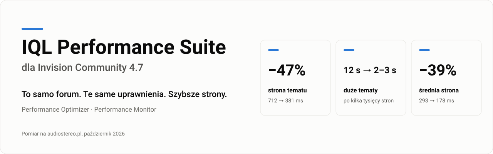
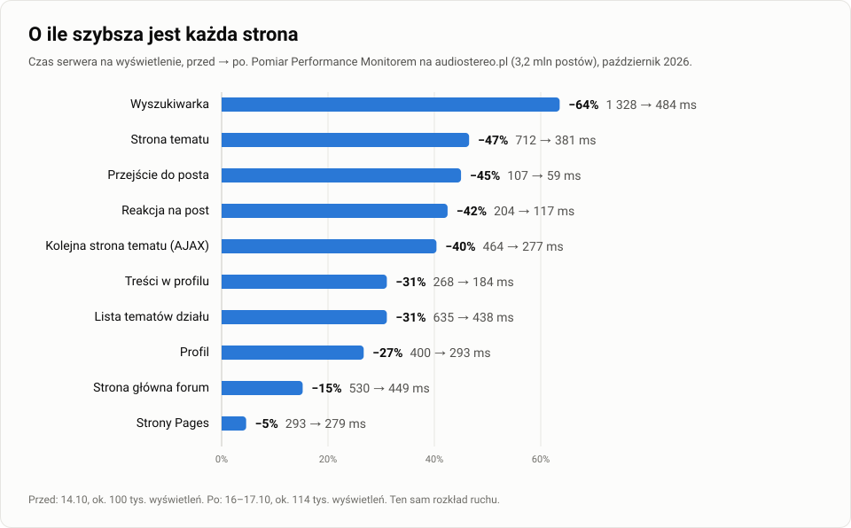

**IQL Performance Suite** przyspiesza fora na Invision Community 4.7 bez zmiany tego, co pokazują. To dwa pluginy: **Performance Optimizer** usuwa pracę, którą IPS wykonuje niepotrzebnie, a **Performance Monitor** mierzy każdą stronę, więc zysk widać na własnym forum.

[English](README.md) · [Changelog](CHANGELOG.md) · [iql.pl](https://iql.pl)

To repozytorium jest publicznym kanałem wydań: aktualne wersje, changelog i wyniki. Kodu ani plików pluginów tu nie ma.

## Aktualne wersje

| Plugin | Wersja | Wydana | Dla |
| --- | --- | --- | --- |
| Performance Optimizer | 1.18.0 | 2026-10-19 | Invision Community 4.7 |
| Performance Monitor | 1.7.0 | 2026-10-19 | Invision Community 4.7 |

IPS sam sprawdza nowe wersje (na razie każda kopia ma licencję dożywotnią, bez klucza): każdy plugin czyta swój plik w tym repozytorium ([`optimizer/latest.json`](optimizer/latest.json), [`monitor/latest.json`](monitor/latest.json)), a ACP pokazuje przy pluginie plakietkę „nowa wersja”.

## Wyniki

**Duże tematy** po kilka tysięcy stron otwierały się około 12 s, a teraz najwyżej 2–3 s. Główną przyczyną było jedno zapytanie IPS o pierwszy i ostatni post tematu, które szukało po indeksie dat całego forum: 4,018 s → 0,001 s na forum z 3,2 mln postów.

Wynik zależy od forum: wielkości, motywu, dodatków, hostingu i odległości do bazy. Największy zysk jest na dużych forach z bazą na osobnym serwerze, z długimi tematami, wieloma frazami językowymi, blokami Pages i klubami. Performance Monitor pokazuje przed i po na Twoim forum.

## Co gwarantujemy

| Gwarancja | Jak to sprawdzamy |
| --- | --- |
| Ten sam wynik co czysty IPS: te same strony, posty, listy i odpowiedzi API | Każdy przypadek testowy idzie dwa razy, czystym IPS i z poprawką, a wyniki muszą być identyczne, także na prawdziwej MariaDB 10.4 z losowymi danymi. |
| Uprawnienia bez zmian: żadnego wycieku działów ani ukrytych treści | Uprawnienia sprawdza dalej kod IPS. Testy idą dla 5–6 oglądających (gość, członek, grupy dodatkowe, admin, członek klubu), a celowo zepsute warianty, np. bez warunku uprawnień, muszą je wywalić. |
| Każdą poprawkę można wyłączyć osobno | Przełącznik w ACP. Test sprawdza, że po wyłączeniu kod pluginu się nie uruchamia. |
| Awaria Redisa nie psuje forum | Przy błędzie Redisa poprawka oddaje sprawy kodowi IPS. Każda poprawka oparta na Redisie ma test z wyłączonym Redisem. |
| Zmiany zrobione w IPS widać od razu | Dane trzymane dłużej niż jedno wejście (frazy językowe, listy klubów) przełączają się na nową wersję przy każdym zapisie przez IPS. Testy edycji, dodania i usunięcia. |
| Bez zmian w strukturze bazy i w plikach IPS | Plugin nie dodaje tabel, kolumn ani indeksów. Odinstalowanie zostawia czysty IPS. |
| Zgodność z innymi dodatkami | Test ładuje wszystkie klasy z hookami zainstalowanych aplikacji. Konflikt, który położyłby forum, wychodzi przed wydaniem. |

Jedyna zamierzona różnica względem IPS: maile z powiadomień wychodzą tuż po wysłaniu strony, a nie przed. To te same maile, w tej samej kolejności. Poprawka dla Elasticsearcha (1.12.0) naprawia błąd IPS: przy „Maximum Results” poniżej 1000 indeks dostaje to, co IPS wysyła przy 1000 i więcej.

## Co poprawia Performance Optimizer

| Poprawka | Co IPS robił źle | Zmierzony efekt |
| --- | --- | --- |
| Podmiana tłumaczeń | Przechodził całą stronę osobno dla każdej frazy, cztery razy (ok. 11 tys. przejść na stronę tematu) | Temat: 403 → 32 ms; strona 1,2 MB: 2,3 → 0,04 s |
| Tłumaczenia w API | Dla każdego tekstu odpowiedzi kodował od nowa wszystkie frazy | Duża odpowiedź: 2,4–2,8 → 0,04–0,05 s, koniec timeoutów aplikacji |
| Pierwszy i ostatni post tematu | Szukał po indeksie dat całego forum | 4,018 → 0,001 s na zapytanie; od 1.17.0 ten sam post co w IPS także przy dwóch postach z tej samej sekundy |
| Strony dużych tematów (1.13.0) | Przy pierwszych i ostatnich stronach szukał po indeksie dat całego forum | Strona 1 tematów z 12–110 tys. postów: 0,6–3,6 s → 0,5–0,7 ms (baza testowa, 3,1 mln postów) |
| Strony tematu w REST API dla moderatorów (1.16.0) | Z hidden=1 przy pierwszych i ostatnich stronach dużych tematów szukał po indeksie dat całego forum | 0,1–1,9 s → 0,3–1,4 ms (baza testowa, 0,5 mln postów); 2–14 s → 0,5 ms (3,2 mln postów) |
| Pola profilu przy postach (1.14.0) | Pobierał listę pól osobno dla każdego autora na stronie, a w tematach w archiwum także wartości każdego autora osobno | Ok. 9 ms na stronę tematu; temat w archiwum z 16 autorami: 50 → 20 zapytań |
| Pola profilu w REST API (1.15.0) | Pobierał wartości pól autora osobno dla każdego posta, tematu i rekordu w odpowiedzi, tę samą osobę wiele razy | Lista 35 rekordów 6 autorów: 27–28 → 6 zapytań (przedtem 17,5 na stronę postów tematu, 35 na listę rekordów) |
| Adresy plików w postach | Podmieniał znacznik osobno dla każdego obrazka | 160 postów: 198 → 4 ms |
| Wyróżnienia (recognize) | Pytał bazę przed sprawdzeniem uprawnienia | Ok. 50 zapytań mniej na stronę tematu |
| Datastore z Redisa | Pobierał każdy klucz osobno | Ok. 130 poleceń Redisa mniej na wejście |
| Kluby działów | Klub każdego działu osobnym zapytaniem | Wyszukiwarka: ok. 270 zapytań → 3–4 |
| Drzewo działów | Poddziały każdego działu osobnym zapytaniem | Wyszukiwarka: ok. 490 zapytań i 410 ms → kilka zapytań |
| Drzewo motywów | Motywy podrzędne osobno, na każdej stronie | Ok. 8 zapytań → 1–2 na każdej stronie |
| Strony baz Pages | Każda strona bazy osobnym zapytaniem | Ok. 14 zapytań → 2 na temat i reakcję |
| Frazy językowe z Redisa | Zapytanie z ok. 2 800 frazami na każdej stronie | Ok. 26 ms → brak zapytania |
| Kluby autora posta | Dwa zapytania na każdy post | Ok. 44 zapytania i 53 ms na temat → prawie 0 |
| Temat bez całego drzewa działów | Wczytywał ok. 500 działów przed każdym tematem | Ok. 40 ms na wejście w temat |
| Notatki do postów (dodatek postnotes) | Dwa zapytania na post | 23 zapytania i 21 ms → 1 zapytanie |
| Rozszerzenia aplikacji | Czytał i dekodował plik przy każdym wywołaniu | Ok. 52 ms na stronę tematu |
| Maile z powiadomień | Wysyłał je przez SMTP, zanim strona wróciła do klikającego | Reakcja nie czeka ok. 240 ms na serwer poczty |
| Kopie szablonów na dysku | Po czyszczeniu cache potrafił przepisywać starą kopię przy każdym wejściu | 50–70 ms na stronę tematu i koniec błędów „Class … not found” |
| Bloki Pages | Każdy blok i jego kategoria osobnym zapytaniem | Bloki tematu: 52 → 18 ms; widżety boczne: 5 zapytań mniej |
| Elasticsearch przy „Maximum Results” poniżej 1000 | Elasticsearch po cichu odrzucał część zmian w indeksie (znacznik ostatniego posta, usuwanie skasowanej treści) | Forum z 500: 38 908 postów ze znacznikiem w 29 610 tematach; teraz każda taka zmiana przechodzi |

Ustawienia pokazują przy każdej poprawce, czy działa na tym forum, a jeśli nie, dlaczego: brak Pages, wyłączone kluby, brak Redisa i tak dalej. Poprawka dla części IPS, której forum nie używa, nic nie robi.

## Co mierzy Performance Monitor

Próbkę wejść: czas każdej strony, zapytania SQL pogrupowane według wzorca z linią kodu, która je wysłała, szablony, bloki Pages, wywołania HTTP (np. Elasticsearch), profil PHP (z rozszerzeniem excimer) oraz najwolniejsze wejścia i to, na co czekały. Ma raport w ACP, blok na pulpicie z wykresem z 48 godzin, porównanie przed i po oraz eksport JSON. Tylko mierzy, a wyniki zapisuje w Redisie po wysłaniu strony.

## Poza pluginami: własne szablony i dodatki

Performance Monitor pokazuje też wolny kod spoza samego IPS: własne szablony Pages, bloki i dodatki innych autorów. Na tym samym forum poprawiliśmy je zmianą kilku linijek w każdym:

| Co było wolne | Przyczyna | Przed → po |
| --- | --- | --- |
| Strony FAQ (szablon bazy Pages) | Menu boczne wykonywało zapytanie o listę artykułów osobno dla każdej kategorii, ok. 30 razy na stronę | 2,85 s → 0,46 s na stronę |
| Strony typów sprzętu (własny szablon rekordu) | Liczenie porównywało pole tekstowe z liczbą, więc baza nie mogła użyć indeksu | 4,1 s → 0,27 s na stronę |
| Dodatek trybu nocnego | Pytał bazę przy każdym sprawdzeniu motywu, 10 razy na stronę dla każdego gościa | 10 zapytań → 0 na stronę |
| Dodatek czatu | Ładował 228 KB JavaScriptu na każdej stronie wszystkim, choć czat widzą tylko admini | Ładuje się tylko tym, którzy widzą czat |

## Wymagania

- Invision Community 4.7 (sprawdzone na 4.7.25)
- PHP 8.0, 8.1 lub 8.2
- MySQL albo MariaDB (sprawdzone na MariaDB 10.4)
- Zalecane: Redis na datastore i cache oraz PHP-FPM. Kilka poprawek ich potrzebuje, a ustawienia pokazują które.

## Dostępność

Wkrótce na [iql.pl](https://iql.pl).

## Pomoc przy Twoim forum

Wolne strony, których pluginy nie naprawią same, np. własne szablony, bloki Pages czy dodatki, możemy poprawić odpłatnie. Wyślij nam eksport z Performance Monitora i krótko opisz, co jest wolne. Powiemy, co to powoduje i ile kosztuje poprawka, a każdą poprawkę dostajesz z pomiarem przed i po. Każda liczba na tej stronie pochodzi z takiej samej pracy na żywym forum, więc znamy Invision Community od środka. Kontakt: [iql.pl](https://iql.pl).
